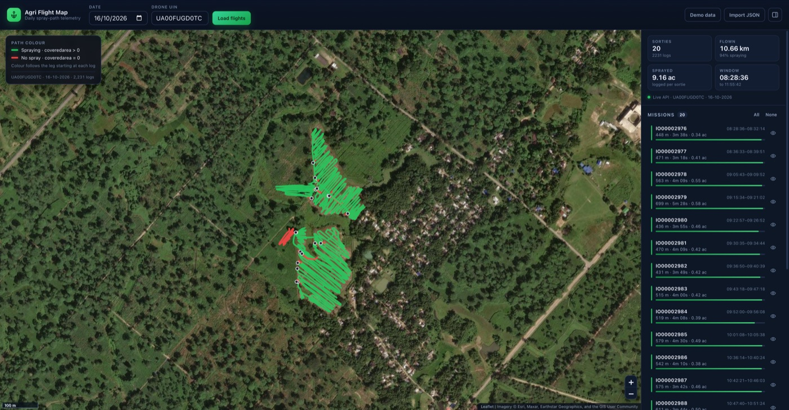
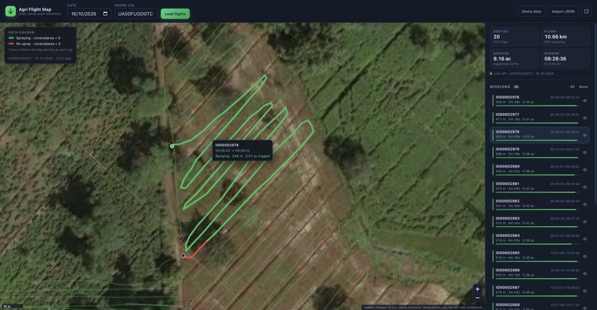

# Agri Flight Map

React + Vite + TypeScript app that reads the daily drone telemetry endpoint and draws every
flight path of the day on a free OpenStreetMap / Esri basemap.

Each leg is coloured by the spray state reported in the telemetry:

- **Green** — the log a leg starts from reports `coveredarea > 0` (the pump was running).
- **Red** — `coveredarea` is `0` or missing (idle / transit / landing).



## Run it

```bash
npm install
cp .env.example .env        # then paste the bearer token into VITE_API_TOKEN
npm run dev                 # http://localhost:5173
```

Production build:

```bash
npm run build && npm run preview
```

The first load calls the live API with the date/UIN from `.env`. If the call fails (offline,
rejected token), the app falls back to the bundled sample in `public/sample/` and explains why
in a banner, so the map is never empty.

## Deploy to Vercel

The repo is Vercel-ready (`vercel.json` pins the Vite build) and ships a serverless proxy in
`api/telemetry.js`, so the bearer token never reaches the browser bundle.

1. Import the GitHub repo at vercel.com/new (framework: Vite), or run `npx vercel --prod`.
2. Add the environment variables below in Settings → Environment Variables, then redeploy.

| Variable | Where | Value |
| --- | --- | --- |
| `API_TOKEN` | server (proxy) | bearer token for the telemetry API |
| `API_BASE` | server (optional) | defaults to `https://apidata.iotechworld.com` |
| `VITE_UIN` | build (optional) | default drone UIN shown in the header |
| `VITE_DATE` | build (optional) | default date, `yyyy-mm-dd` |
| `VITE_API_TOKEN` | build (optional) | only for a token-in-bundle direct mode; leave empty when using the proxy |

Data path: the browser posts `{ uin, date }` to `/api/telemetry`; the handler attaches
`Authorization: Bearer $API_TOKEN`, validates `uin`/`date`, forwards to the upstream API and returns
its JSON unchanged. The browser never calls the upstream host directly, so there is no CORS
preflight and no token in client JavaScript.

`npm run dev` mounts the same `api/telemetry.js` handler as Vite middleware, reading
`VITE_API_TOKEN` / `VITE_API_BASE` from `.env` on the dev server. Dev and production therefore use
one code path.

## API

`POST https://apidata.iotechworld.com/fetchapi/data`

```json
{ "uin": "UA00FUGD0TC", "date": "16-10-2026" }
```

Headers: `Content-Type: application/json`, `Authorization: Bearer <token>`.
The date is `dd-mm-yyyy`; the UI date picker converts to/from `yyyy-mm-dd` automatically.

Response shape:

```
{ "data": [ { "code": 200, "message": "...", "response": { "UIN": "...", "MISSION": [ ...logs ] } } ] }
```

Each log carries `LAT`, `LONG`, `time`, `MISSIONID`, `Missionmode`, `coveredarea` (`"0.42 Acre"`),
`battery`, `altitude`, `speed`, `flow rate`, etc. `coveredarea` is cumulative per sortie, so it is
read as acres and converted when the API returns `ha` / `m²`.

The endpoint replies with `Access-Control-Allow-Origin: *`, so the browser can call it directly —
no proxy is required.

## Features

- All paths of the day on one map, split into green (spraying) and red (not spraying) runs.
- Mission list with distance, duration, logged area, battery window and a per-sortie spray bar.
- Click a path or a mission to highlight and zoom to it; hide single missions or all of them.
- Hover tooltips with mission id, time window, spray state and leg length.
- Free basemaps: OpenStreetMap streets, Esri World Imagery satellite, CARTO dark.
- Drag a telemetry JSON file onto the map to inspect another day offline.
- Statistics: sorties, flown distance, spraying share, logged area, first/last log time.
- Responsive: side panel becomes a bottom sheet on narrow screens.



## Spray-colour rule

Within a mission the logs are consecutive GPS fixes. For the leg `log[i] → log[i+1]`:

| Mode (Settings) | Green when |
| --- | --- |
| `cumulative` (default) | `coveredarea(log[i]) > 0` — matches the requested rule |
| `incremental` | `coveredarea(log[i+1]) > coveredarea(log[i])` — only the legs where area actually grew |

`incremental` is useful because `coveredarea` is cumulative: once spraying starts, the default rule
keeps every following leg green, while the incremental view isolates the exact passes.

Segments never join two different missions: each sortie is drawn as its own path, so take-off /
landing gaps do not create fake lines across the field.

## Project layout

```
src/
  App.tsx                 state, loading, drag & drop, selection
  config.ts               env + runtime token handling
  types.ts                telemetry / mission / dataset types
  lib/api.ts              API client, date conversion, sample loader
  lib/dataset.ts          normalisation, grouping, spray rule, statistics
  lib/geo.ts              haversine distance
  lib/format.ts           distance / area / duration formatting
  components/Header.tsx   date + UIN query bar
  components/MapView.tsx  Leaflet map, path rendering, tooltips
  components/Sidebar.tsx  statistics, mission list, settings
  components/Legend.tsx   colour legend overlay
public/sample/            bundled 16-10-2026 response used as a fallback
```

## Troubleshooting

**`504 Gateway Time-out` from the API, shown in the browser as a CORS error.**
The upstream nginx returns a 504 without CORS headers when its data backend stalls, which browsers
report as `No 'Access-Control-Allow-Origin' header`. The proxy turns that into a JSON error and the
app falls back to demo data with an explanatory banner. Nothing to fix client-side: with a valid
token the upstream answers instantly when healthy (an invalid token returns `404 Partner not found`
in ~0.3 s), so a 60 s hang means the telemetry backend itself is stuck.

## Notes

- Map tiles are free services (OpenStreetMap, Esri World Imagery, CARTO) and are used with
  attribution, which the map control displays. For heavy production traffic, switch to a tile
  provider with a proper usage plan.
- The bearer token lives in `.env` (git-ignored) or browser `localStorage` when saved from the
  settings panel. Anything shipped to a browser is readable by the user — for a public deployment,
  put a small server-side proxy in front of the API and keep the token on the server.
- `MISSIONID`-less `BOOT` records (14 in the sample) are counted but not drawn: they are single
  points with no mission, so there is no path to render.
